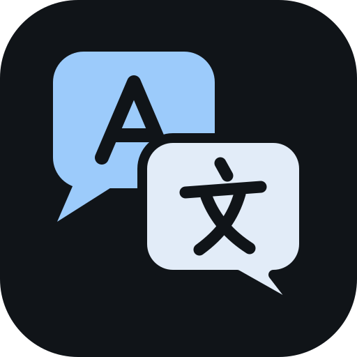

<div align="center">



# Dux Translate

**A small translator for the top bar and the launcher of [Dux Shell](https://github.com/duxlabs-dev/dux-shell).**

Google Cloud Translation, DeepL or any OpenRouter model. Pure QML: no Python, no extra packages.

[](https://github.com/exec-cmd/dux-translater/actions/workflows/ci.yml)


[](LICENSE)

English | [Русский](README_RU.md)


</div>

## Features

- **Popout in the bar.** Click the icon, type or paste text, press Enter.
- **Right click on the icon** translates the text in the clipboard and opens the popout.
- **Launcher.** Type `tr hello` in the shell launcher and press Enter: the translation is copied.
- **Image translation** through OpenRouter vision models: paste a screenshot with Ctrl+V.
- **Language pairs.** Searchable language lists, Auto source, a swap button, the last four pairs as chips.
- **Interface in English and Russian**, following the shell language.
- Keys go only into request headers, never into URLs, command lines or logs.

## Requirements

- Dux Shell 2.x (tested on 2.1.2 with niri). DankMaterialShell 1.x is no longer supported; stay on the last 1.x commit of this plugin (`a6bb3b9`) for it.
- An API key for one provider (see [Providers and keys](#providers-and-keys))
- `wl-clipboard`, only for pasting images

## Install

```bash
git clone https://github.com/exec-cmd/dux-translater.git
cd dux-translater
./install.sh
dms ipc call plugins reload duxTranslate
```

`install.sh` copies `src/` to `~/.config/dms/plugins/duxTranslate`. `--link` makes a symlink instead, so edits in the repo apply after a reload. An existing directory that is not this plugin is never replaced without `--force`.

## Add to the bar

1. Settings → Plugins → Scan for Plugins, then turn on **Dux Translate**.
2. Pick a provider and enter its API key in the plugin settings.
3. Settings → Dank Bar → add the **Dux Translate** widget to a section.

## Use

**Popout.** Enter translates and Shift+Enter adds a new line. Type in a language list to search it. The source language can be Auto. The swap button swaps the languages and moves the last translation into the input. The last four language pairs you used appear as chips under the lists, so one click switches back. The current pair is remembered.

**Right click.** Right click on the bar icon translates the clipboard text and opens the popout with the result.

**Launcher.** Type `tr ` (with a space) and a text in the shell launcher, then press Enter. The text is translated from the detected language into the target language of the popout, the result is copied and shown in a notification. The translation runs on Enter, not while you type.

**Images.** Copy an image (for example a niri screenshot) and press Ctrl+V in the input or click **Image**. Images work only with OpenRouter and a model that accepts image input (the default `z-ai/glm-5.3-flash` does). Google Cloud Translation v2 and DeepL `/v2/translate` accept text only.

## Providers and keys

| Provider | Key | Notes |
|---|---|---|
| Google Cloud Translation | [Cloud Console](https://console.cloud.google.com/apis/credentials), with the Cloud Translation API enabled | Uses the Basic v2 API, which accepts API keys. |
| DeepL | [DeepL API account](https://www.deepl.com/your-account/keys) | Free keys end in `:fx` and use `api-free.deepl.com` automatically. |
| OpenRouter | [openrouter.ai/keys](https://openrouter.ai/keys) | Default model `z-ai/glm-5.3-flash`. The model id, reasoning level and system prompt are editable. **Reasoning**: Model default sends nothing; Off to Extra high set `reasoning.effort` (Off is fastest; models that always reason may reject it). `{source}` and `{target}` in the prompt become language names. |

API keys are stored as **plain text** in the shell's `plugin_settings.json` (in `~/.config/dms/`), which every plugin can read. Use keys limited to the translation API, with a spending cap. Keys are sent only in request headers, never in URLs or command lines.

The text you translate is sent to the selected provider.

## Keyboard shortcut

Add a bind to `~/.config/niri/config.kdl`:

```kdl
binds {
    Mod+Alt+T { spawn "dms" "ipc" "call" "widget" "toggle" "duxTranslate"; }
}
```

The widget must be on the bar for the shortcut to work.

## Upgrading from DMS Translate 1.x

The plugin id changed from `dmsTranslate` to `duxTranslate`. `install.sh` removes the old plugin directory. On the first load the new plugin copies your provider, keys, model, prompt, language pair and recent pairs from the old id, and leaves values that already exist. Two steps stay manual: turn on **Dux Translate** in Settings → Plugins, add its widget to the bar again, and change `dmsTranslate` to `duxTranslate` in your keybind. The old `dmsTranslate` entry stays in `plugin_settings.json` until you delete it.

## Update and remove

```bash
git pull && ./install.sh   # not needed with --link; just reload
./uninstall.sh
```

`uninstall.sh` removes only the plugin directory. The settings and keys stay in `plugin_settings.json` under `duxTranslate`; delete that entry by hand if you need to.

## Development

```bash
node --test tests/*.test.mjs              # request building, response parsing, migration
shellcheck install.sh uninstall.sh
./install.sh --link && dms ipc call plugins reload duxTranslate
```

See [AGENTS.md](AGENTS.md) for the repository rules.

## License

MIT. See [LICENSE](LICENSE).
