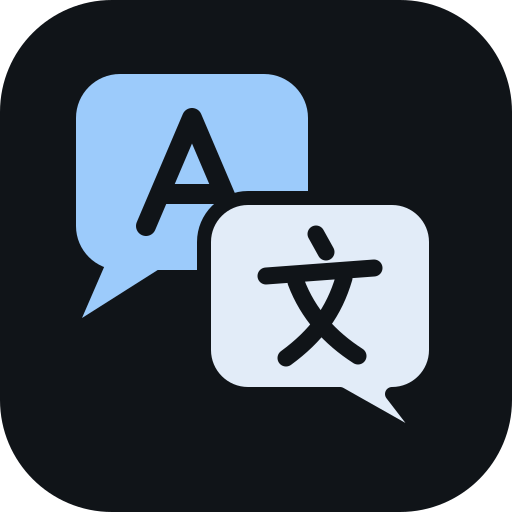

<div align="center">



# Dux Translate

**Небольшой переводчик для верхней панели и лаунчера [Dux Shell](https://github.com/duxlabs-dev/dux-shell).**

Google Cloud Translation, DeepL или любая модель OpenRouter. Чистый QML: без Python и дополнительных пакетов.

[](https://github.com/exec-cmd/dux-translater/actions/workflows/ci.yml)


[](LICENSE)

[English](README.md) | Русский


</div>

## Возможности

- **Окно в панели.** Нажмите на иконку, введите или вставьте текст, нажмите Enter.
- **Правый клик по иконке** переводит текст из буфера обмена и открывает окно.
- **Лаунчер.** Введите `tr привет` в лаунчере шелла и нажмите Enter: перевод копируется.
- **Перевод изображений** через модели OpenRouter с поддержкой картинок: вставьте скриншот по Ctrl+V.
- **Пары языков.** Списки языков с поиском, источник Auto, кнопка обмена, четыре последние пары чипами.
- **Интерфейс на английском и русском**, по языку шелла.
- Ключи передаются только в заголовках запросов, никогда в URL, командной строке или логах.

## Требования

- Dux Shell 2.x (проверено на 2.1.2 с niri). DankMaterialShell 1.x больше не поддерживается; для него остаётся последний коммит 1.x этого плагина (`a6bb3b9`).
- API-ключ одного из провайдеров (см. [Провайдеры и ключи](#провайдеры-и-ключи))
- `wl-clipboard`, только для вставки картинок

## Установка

```bash
git clone https://github.com/exec-cmd/dux-translater.git
cd dux-translater
./install.sh
dms ipc call plugins reload duxTranslate
```

`install.sh` копирует `src/` в `~/.config/dms/plugins/duxTranslate`. С `--link` вместо копии создаётся симлинк, и правки в репозитории применяются после перезагрузки плагина. Существующий каталог другого плагина без `--force` не заменяется.

## Добавление на панель

1. Settings → Plugins → Scan for Plugins, затем включите **Dux Translate**.
2. В настройках плагина выберите провайдера и введите его API-ключ.
3. Settings → Dank Bar → добавьте виджет **Dux Translate** в нужную секцию.

## Использование

**Окно.** Enter запускает перевод, Shift+Enter добавляет новую строку. В списках языков работает поиск: просто начните печатать. Язык источника может быть Auto. Кнопка обмена меняет языки местами и переносит последний перевод в поле ввода. Четыре последние использованные пары языков показаны чипами под списками, переключение в один клик. Текущая пара запоминается.

**Правый клик.** Правый клик по иконке в панели переводит текст из буфера обмена и открывает окно с результатом.

**Лаунчер.** Введите в лаунчере шелла `tr ` (с пробелом) и текст, затем нажмите Enter. Текст переводится с определённого языка на целевой язык из окна перевода, результат копируется и показывается в уведомлении. Перевод запускается по Enter, а не во время набора.

**Изображения.** Скопируйте картинку (например, скриншот niri) и нажмите Ctrl+V в поле ввода или кнопку **Image**. Картинки работают только с OpenRouter и моделью, которая принимает изображения (модель по умолчанию `z-ai/glm-5.3-flash` принимает). Google Cloud Translation v2 и DeepL `/v2/translate` принимают только текст.

## Провайдеры и ключи

| Провайдер | Ключ | Примечания |
|---|---|---|
| Google Cloud Translation | [Cloud Console](https://console.cloud.google.com/apis/credentials), с включённым Cloud Translation API | Используется Basic v2 API, он принимает API-ключи. |
| DeepL | [Аккаунт DeepL API](https://www.deepl.com/your-account/keys) | Бесплатные ключи заканчиваются на `:fx` и автоматически идут на `api-free.deepl.com`. |
| OpenRouter | [openrouter.ai/keys](https://openrouter.ai/keys) | Модель по умолчанию `z-ai/glm-5.3-flash`. Id модели, уровень размышлений и системный промпт можно изменить. **Reasoning**: Model default ничего не отправляет; от Off до Extra high задают `reasoning.effort` (Off быстрее всего; модели, которые размышляют всегда, могут его отклонить). `{source}` и `{target}` в промпте заменяются названиями языков. |

API-ключи хранятся **открытым текстом** в `plugin_settings.json` шелла (в `~/.config/dms/`), и этот файл может прочитать любой плагин. Используйте ключи, ограниченные API перевода, с лимитом расходов. Ключи передаются только в заголовках запросов, никогда в URL или командной строке.

Переводимый текст отправляется выбранному провайдеру.

## Горячая клавиша

Добавьте бинд в `~/.config/niri/config.kdl`:

```kdl
binds {
    Mod+Alt+T { spawn "dms" "ipc" "call" "widget" "toggle" "duxTranslate"; }
}
```

Чтобы клавиша работала, виджет должен быть на панели.

## Переход с DMS Translate 1.x

Id плагина изменился с `dmsTranslate` на `duxTranslate`. `install.sh` удаляет старый каталог плагина. При первой загрузке новый плагин копирует из старого id провайдера, ключи, модель, промпт, пару языков и недавние пары; значения, которые уже есть, не перезаписываются. Вручную остаются три шага: включите **Dux Translate** в Settings → Plugins, заново добавьте его виджет на панель и замените `dmsTranslate` на `duxTranslate` в бинде. Старая запись `dmsTranslate` остаётся в `plugin_settings.json`, пока вы её не удалите.

## Обновление и удаление

```bash
git pull && ./install.sh   # с --link не нужно, достаточно перезагрузки
./uninstall.sh
```

`uninstall.sh` удаляет только каталог плагина. Настройки и ключи остаются в `plugin_settings.json` под `duxTranslate`; при необходимости удалите эту запись вручную.

## Разработка

```bash
node --test tests/*.test.mjs              # сборка запросов, разбор ответов, миграция
shellcheck install.sh uninstall.sh
./install.sh --link && dms ipc call plugins reload duxTranslate
```

Правила репозитория описаны в [AGENTS.md](AGENTS.md).

## Лицензия

MIT. См. [LICENSE](LICENSE).
